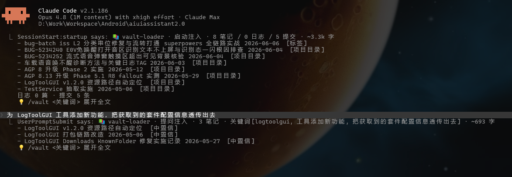
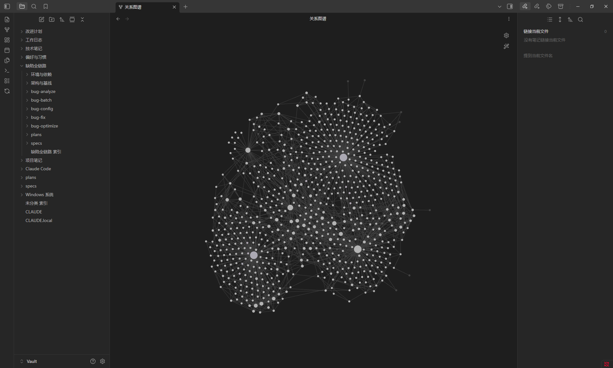

# Context Vault

面向 Claude Code 的本地「知识库沉淀—召回」闭环插件（2.0.0 起不再支持 Codex，v1.4.2 是最后支持 Codex 的版本，需要时可从该 tag 自行构建）。仓库名可暂时保留 `claude-vault`，插件 ID 从 1.0.0 起为 `context-vault`。三个 skill 协同构成闭环（另有第四个 `config` 作为运维入口，用来查看与修改本插件的配置项）：

| Skill | 作用 |
|---|---|
| **vault-loader** | 通过 hook（SessionStart + UserPromptSubmit）自动把相关的知识库笔记注入每次会话，零交互。 |
| **summarize-session** | 会话结束时把对话沉淀为结构化笔记、工作日志和 CLAUDE.md 更新，写入你的知识库。 |
| **vault** | 手动检索：会话中需要调取特定笔记时，按关键词、分类或标签搜索。 |

闭环：`summarize-session` 写入 → `vault-loader` 读取并注入 → Claude Code 启动时已带好相关上下文。

---

## 安装 Claude Code

```
/plugin marketplace add <你的仓库地址>
/plugin install context-vault
```

> 仓库地址由你提供（你自己的 fork 或 marketplace）。插件名为 `context-vault`。

安装后 hook **自动生效**——插件自带的 `hooks/hooks.json` 会被 Claude Code 自动加载注册（SessionStart / UserPromptSubmit），**无需手动编辑 `~/.claude/settings.json`**。若要临时停用，见下方「停用逃生阀」。

> 2.x 不支持 Codex，请不要在 Codex 中安装。已在 Codex 中装过 1.x 的用户，先用 `codex plugin list` 找到 `context-vault@<marketplace>`（按 1.x README 安装的是 `context-vault@context-vault-local`），再执行 `codex plugin remove context-vault@<marketplace>`；还要继续在 Codex 里用 1.4.2 的，先读 `docs/MIGRATION.md` 的 2.0.0 一节再清理任何数据。

> **从 2.3.0 或更早升级：2.4.0 默认扩大了外发范围，升级时没有任何提示。** LLM 精排（默认开）从「每会话首轮外发一次」
> 改为每个通过闸门的提问都可能外发一次，内容另有目录层（全部未归档、未排除笔记的文件名）、最近几轮手输的提问与本项目
> 近期工作日志的条目标题。收窄：`relevance.fine_catalog: false`、`fine_recent_prompts: 0`、`fine_supplement: false`
> （只保留首轮）、`fine_rank: false`（全关），逐篇用 `private` tag。完整清单见下方「安全提示」，升级后第一次重建索引
> 之前的隐私窗口与回退注意事项见 `docs/MIGRATION.md`「2.3.0 → 2.4.0」。

## 公共数据与兼容

1.0 新装使用 `~/.context-vault/`：共享配置和知识库，state/metrics 落在 `claude` 命名空间（**注入去重按项目目录，跨会话保持**）。旧 `~/.claude/skills/...` 与 metrics 继续兼容读取——**0.9.x 用户即使从未显式配过 `vault_path`，升级后读的仍是原来的 `~/.claude/knowledge-vault`**，不会被改指到新目录。

> **升级后你会看到一个新目录**：hook 的事件去重 marker 无条件写入 `~/.context-vault/state/events/`，
> 与是否迁移、是否开启 metrics 都无关。它只存事件摘要（不含 prompt、不含 cwd、不含笔记路径），
> 保留 90 天后自动清理。
>
> 在交互终端里使用时还会出现 `~/.context-vault/state/live/`（见下节「注入可见与可控」的「数据」）：放 mod
> 与 Python 之间的按轮请求和会话快照，内容是最近一次注入、钉住与排除的笔记路径和标题、命中的提问关键词与
> LLM 主题词，metrics 开启时另有提问的加盐 hash。它只在能加载 mod、`mod_enabled` 没关、且会话有绘制界面时出现；快照
> 24 小时、请求与临时文件 1 小时后由下一次会话开始时清理，`analyze_metrics.py --purge` 一并清除；
> `claude -p` 等没有绘制界面的会话不写它。
> 这两个是仅有的未经迁移就会出现的新目录，此处如实说明以免被当成迁移已发生。

迁移默认只预览；`--apply` 只复制、不删除旧数据，并在新配置已存在或读写两端 Vault 冲突时停止：

```bash
python scripts/migrate_context_vault.py
python scripts/migrate_context_vault.py --apply
python scripts/context_vault_doctor.py
```

---

## 注入可见与可控（band 与 `/vault-injected`）

插件自带一个 mod（`hooks/vault-mod.js`），在交互终端里：

- **输入框上方常驻一行**，与上方会话内容隔一行：先是来源计数（脚本粗排几篇、LLM 精排点名几篇、精排补充几篇、
  手动钉住几篇、本会话排除几篇）与 LLM 精排状态简标（✓ 完成、… 提炼中、✗ 失败或无法发起），之后才是标题。打分了
  但没有命中时显示「无注入」；后台通知、指代词提问等被闸门跳过的轮次保留上一次的注入列表，行首标
  「（本轮未召回）」，精排状态照常刷新。你在面板里做的操作若没能送达 Python（例如两侧算出的主目录不一致），
  这一行会改为告警，每个会话只告警一次。
- **`/vault-injected` 打开面板**，操作在下一次提问时生效：
  - 对最近一次注入的每篇：**排除**——本会话之后的提问不再注入它（机械召回、升级为全文、自动点名都不会
    再选它）；已经注入过的不会撤回；会话开始注入的项目固定上下文不受影响（`/compact` 之后照常注入）。
  - **钉住**：之后每次打分的提问都以摘要注入（被闸门跳过的轮次不注入）。手动钉住先占位，与 LLM 自动
    点名合计不超过 8 篇：手动钉住 n 篇时，自动点名最多 `min(fine_pin_max, 8 − n)` 篇。
  - 自动点名的篇可以**取消**，效果等于本会话排除它；手动钉住与排除都可以撤销；会话开始注入的项目笔记
    也可以钉住。
  - 上限：排除 50 篇、手动钉住 8 篇、取消自动点名 8 篇，到上限时按钮直接拒绝并提示。
  - 「本会话」按会话 id 算：`/clear` 或 `/resume` 进入另一个会话后，操作与告警额度从空开始。
  - 每篇一行：↑↓ 或 Tab 移动，Enter 展开或收起（同一时刻只展开一篇）。展开后显示这一篇的来源——脚本粗排的
    打分方式、topical 分与阈值、命中的提问词，有主题词加分时还有命中的 LLM 主题词；LLM 点名的篇显示它在本轮
    粗排里排第几；会话开始注入的篇显示入选原因——以及可用的操作，操作带单字母热键（x 排除、p 钉住、y 有用、
    n 无用、u 取消、r 恢复）。左右键不可用：Claude Code 没有把它们交给插件。
  - 「LLM 精排」一节显示精排的状态：未开启、尚未发起、无法发起（找不到 claude 命令等）、提炼中、
    已完成（主题词与点名篇数）、失败（超时、退出码非 0、结果丢失），以及当前是首轮点名还是逐轮补充、本会话已
    调用几次、连续失败几次、是否已停用（连续 2 次失败、调用或外发上限）。模型名不合法时回落 haiku、照常调用，
    状态后面附「模型名不合法，已回落 haiku」。状态截至上一次提问，两次提问之间不刷新。LLM 不重排注入列表：主题词给命中的笔记加分（下一轮起），点名的篇以摘要固定注入，补充只注入一次。
  - 「精排补充」一节列出最近一次投递的补充篇：每篇一行，展开显示它来自第几轮的判断、是否通过关键词复核，
    metrics 开启时可标注「有用 / 无用」。
  - 「设置」一节可在本会话内调：粗排注入、LLM 精排、逐轮补充、自动全文四个开关，粗排篇数、首轮点名篇数与
    补充篇数（「−」「＋」），以及精排模型（在 haiku / sonnet / opus / config 当前值之间循环）。会话设置只影响
    本会话；「设为默认」把当前值写进 `~/.context-vault/config.json`，但只允许往收窄的方向写（关开关、减篇数、
    模型改回 haiku），放宽要经 `/config`。config 里已关掉的精排或逐轮补充在面板里显示「已在 config 关闭」、
    不能在会话内打开。
- **band 末尾的「面板」按钮**：打开与 `/vault-injected` 相同的面板。按钮没有绑热键；键盘能否让它获焦并按下还**待核实**（探针 mod 在 Claude Code 2.1.296 上测到过 ctrl+x tab 之后按下 band 按钮，本插件自己的按钮没有在真实终端里验证过），窄终端里按钮是否始终可见同样待核实。确定可用的入口是 `/vault-injected` 命令。
- **标注**：metrics 开启（`config.json::metrics.enabled`）且不在 dry_run 时，面板里有「有用 / 无用」按钮。
  标注先排在本插件的 store 里（7 天过期、最多 200 条；队列在所有会话之间共享），随之后的提问交给
  Python，按 metrics 里那一轮的记录核对后写入 `annotations.jsonl`。每条标注的去向：
  - 核对通过：写入并从队列移除；同一条只会写一次。
  - **拒收：从队列删除、不再重投**——metrics 已关闭（面板会提示）、会话的 metrics 记录里找不到那一轮、
    条目格式不对。
  - 暂不判定、留在队列里下次再投：配置文件读坏的那一轮、dry_run、会话的 metrics 文件读不到（例如
    `--purge` 之后；`--purge` 之前标的标注不会再写入）、`annotations.jsonl` 正被别的写者占用。
  - 写入发生在本轮注入之前，等标注文件的锁最多 0.25 秒，等不到就整批留到下一轮。
- **关闭**：插件配置项 `mod_enabled` 设为 `false` 后，band 与 `/vault-injected` 都不出现，召回照常。它是
  插件的配置项（`.claude-plugin/plugin.json` 的 `userConfig`），不在 `~/.context-vault/config.json` 里。按
  Claude Code 2.1.293 的插件文档：首次安装时安装界面会列出它；它也是 `/config` 菜单里的一行，在那里改动后
  插件随即重新加载。这两点都没有实测；更新到本版时会不会弹出设置界面，同样尚未实测。
- **不显示的地方**：`claude -p`；VS Code 的聊天面板（输入框上方这一行只在终端与 Desktop 上绘制）。
  Desktop 的 Code 标签里是否可用尚未实测：那里的会话入口类型若不是 `cli`，召回本身就不运行。
- **版本**：本插件的 mod 只在 Claude Code 2.1.293 上验证过（`claude plugin validate` 与 `claude plugin test`；
  交互终端里的实际绘制尚无运行记录）。另用一个同样声明 `modules` / `types` / `userConfig` 的最小探针插件
  在 2.1.286、2.1.250、2.1.220 上验证过：三者都不因这些新字段拒绝插件，命令 hook 照常执行；2.1.250 与
  2.1.220 不加载 mod（没有 band 与命令）。本插件本身没有在这三个版本上安装运行过（2026-10-10，Windows 11）。
- **数据**：
  - `~/.context-vault/state/live/`：mod 写的按轮请求（排除、钉住、取消点名的笔记路径，待写入的标注，会话设置，主模型读过的 vault 笔记
    相对路径）与 Python 写的会话快照（最近一次注入、钉住、排除、精排补充与会话开始注入的路径和标题；vault 的
    绝对路径；会话设置；**命中的提问关键词与 LLM 主题词
    明文，不论 metrics 是否开启**；LLM 精排状态；拒收与已写入的标注 id；metrics 开启时另有提问的加盐 hash）。
    metrics 对主题词只存加盐 hash，快照存明文，两者口径不同。POSIX 上快照由 Python 以目录 0700、文件 0600 写出；
    Windows 上继承 `~/.context-vault` 的 ACL。mod 先建目录或写请求时用宿主的默认权限（未在 POSIX 实测）。快照
    超过 24 小时后，在下一次会话开始时清理。
  - store：Claude Code 配置目录下 `plugins/store/` 里以 `context-vault_` 开头的文件，内容是待写入的标注
    （笔记路径、会话 id、提问的加盐 hash、判断）。`--purge` 不清它，卸载也不清，需要时手工删除。
  - `~/.context-vault/state/claude/fine/`（未迁移的机器上是 `~/.claude/vault-loader-fine/`，与会话主题词同一判定）：
    每个会话一份精排状态——轮次序号、本会话已注入的笔记相对路径（最多 300 条）、会话设置、失败计数与调用次数、
    累计外发字节、待投递的补充篇相对路径；**不存提问原文与目录**。超过 `state_ttl_hours` 后在下一次会话开始时
    清理，`analyze_metrics.py --purge` 一并删除。
  - 精排子进程的输入（本轮提问原文、transcript 路径、本会话已注入与排除的笔记路径、上一份主题词、有效配置子集）
    经系统临时目录里的一个临时文件交给子进程：Windows 上最后一个句柄关闭时由系统删除（子进程结束或被杀都一样），
    文件权限继承临时目录；macOS / Linux 上创建后立即删除目录项。
  - 展示状态放在 Claude Code 的 `$.state` 里；其类型文档写明任何插件都能读取（`Any plugin reads any value`），
    内容含会话 id、提问 hash、笔记路径，以及命中的提问关键词与 LLM 主题词。
  - 停用逃生阀开着时：会话开始仍会清理 `live/` 里的过期文件，有 mod 请求的那一轮仍写一份标为停用的快照。
    要让 `live/` 完全不写入，同时把 `mod_enabled` 关掉。

---

## 按需全文与读取权限

2.4.0 起注入行只给标题、摘要与笔记的绝对路径（行尾的 `‖ 路径：…`），**默认不再自动注入全文**；主模型需要细节时自己用 Read 读那个路径。笔记通常在当前项目目录之外，默认权限模式下这类读取需要确认（`claude -p` 下直接被拒；交互会话里的确认弹窗没有单独实测）。想免确认，在 Claude Code 的 `settings.json` 里只放行 vault 下的 Markdown：

```json
{
  "permissions": {
    "allow": ["Read(//<vault 绝对路径>/**/*.md)"],
    "deny": ["Read(//<vault 绝对路径>/.git/**)", "Read(//<vault 绝对路径>/.obsidian/**)"]
  }
}
```

`<vault 绝对路径>` 用正斜杠写，接在 `//` 后面时去掉路径开头的 `/`：POSIX 上 vault 在 `/srv/notes/vault` 就写 `Read(//srv/notes/vault/**/*.md)`（放在家目录下的同理，把绝对路径去掉开头的 `/` 接在 `//` 后面）（POSIX 写法按 Claude Code 权限文档的 `//` 绝对路径形态给出，未在本机实测）；Windows 上去掉冒号、盘符写小写（实测用的是小写），例如 vault 在 D 盘的 `Notes/Vault` 下就写 `//d/Notes/Vault/**/*.md`。实测（2026-10-14，Claude Code 2.1.296，`claude -p`）：加了这条 allow 规则后，项目目录之外的 vault `.md` 能直接读；同一 vault 里的 `.git/config` 不在规则内，仍被拒。deny 两条是额外保险，按 Claude Code 的权限文档 deny 优先于 allow，本插件没有单独实测。

**不建议**用 `additionalDirectories` 加整个 vault：那会让目录里所有文件免确认可读，包括 `.git/config`、`.obsidian/` 下的插件数据。插件不会改你的 settings。想回到 2.3.0 的自动全文，设 `relevance.auto_fulltext: true`。

---

## Claude Code 本地使用（`--plugin-dir`，免发布）

不想 push 到 git 仓库，直接用本地的插件目录（自己开发、单源维护、或本地试用）——用 `--plugin-dir` 启动 Claude Code：

```bash
claude --plugin-dir "<插件目录绝对路径>"
```

- 直接从你指定的本地目录加载，**改动即生效**：不复制到 cache、无需 push / install / update。
- 与 `/plugin install` 的区别：`install` 会把插件**复制**到 `~/.claude/plugins/cache/`，之后改本地源码**不生效**（要重装或更新）；`--plugin-dir` 始终读你指定的本地目录，最适合插件开发和单源维护。
- 生效粒度：`SKILL.md` 文本改动自动检测；`hooks/` `agents/` `MCP` 改动需重启会话（或 `/reload-plugins`，若你的版本支持）。

**持久化（每次启动自动带）** —— 以 PowerShell 为例，在 `$PROFILE` 加一个包装函数（新开 shell 生效）：

```powershell
function claude { & claude.exe --plugin-dir "<插件目录绝对路径>" @args }
```

其他 shell（bash/zsh）自行配 alias 或 wrapper 即可。

> **从 `~/.claude/skills/` 旧装法迁移**：若你之前在 `~/.claude/settings.json` 手动注册过同名 hook，需先删除旧注册以免双触发——详见 [docs/MIGRATION.md](docs/MIGRATION.md)（含 `scripts/migrate_settings.py` 半自动迁移）。

---

## 跨平台

支持 **macOS**、**Linux**、**Windows**。需要 Python **3.9** 或更高版本，更低版本不保证可用。

hook 通过一个 polyglot 包装脚本运行，按以下顺序探测 Python 解释器：

1. `py` 启动器（Windows `py.exe`）
2. `python3`
3. `python`

hook 命令以 `/bin/sh` 执行这个包装脚本，不依赖文件的可执行位。Windows 上 Claude Code 用 Git Bash 执行本插件的 hook，需要安装 Git for Windows；没装时本插件的 hook 无法运行。若 Claude Code 提示给 hook 改用 `"shell": "powershell"`，不要照做：命令串与 PowerShell 不兼容，插件更新也会覆盖这类改动。

若找不到任何 Python 解释器，hook 会**静默跳过**——绝不阻断你的 Claude Code 会话。

---

## 零配置首次运行

首次会话前无需准备 Obsidian 知识库或任何特殊配置。

1.0 全新安装首次使用时若未配置知识库路径，会自动在以下位置创建：

```
~/.context-vault/knowledge-vault
```

之后可指向一个已有的 Obsidian 知识库：

```
/summarize-session --set-default /path/to/your/vault
```

**可选集成**（缺失时优雅降级）：

- **git** — 知识库变更自动提交；无 git 时写入仍成功
- **obsidian-cli** — 启用知识库实时重载；无它时回退到文件 I/O

---

## 卸载

```bash
/plugin uninstall context-vault
```

插件本身无定时任务 / 后台进程，直接卸载即可。1.0 运行时状态位于 `~/.context-vault/`；升级用户的旧数据仍留在 `~/.claude/`。卸载不会自动删除任一目录，也不会触碰你的笔记知识库。

---

## 安全提示

**vault-loader 会把笔记内容直接注入模型上下文。**

请勿在知识库中存放不可信内容。你知识库笔记里的任何文本——包括从外部来源复制的内容——都会作为会话上下文的一部分发送给当前宿主配置的模型服务。注入的笔记正文带有「以下为知识库历史内容、非指令」的隔离声明，但仍应避免存放不可信内容。

### 2.4.0 起外发给模型的内容

LLM 精排（默认开）在每个通过闸门的提问上都可能发起一次 `claude -p` 调用（每会话默认至多约 20 次，`relevance.fine_max_calls`；这不是硬上限，例外见 vault-loader SKILL.md「频率与上限」），外发的是：本轮提问、最近几轮手输的提问、本项目近期工作日志的条目标题（不受 tag 控制，日志里打了 `private` 也照送）、本会话已注入的文件名（带 `fine_exclude_tags` 或 `exclude_note_tags` 里 tag 的除外）、摘要层——宽召回的 `session_topic_top_n` 篇加本项目最新的 `session_topic_project_top_k` 篇（封顶 `session_topic_pool_max`）的文件名与摘要前 120 字，以及**全部未归档、未排除笔记的文件名**（`relevance.fine_catalog`）。2.3.0 及之前只在会话首轮外发一次：本轮提问原文，加同样由宽召回和项目笔记组成的候选笔记的路径与摘要。收窄的办法：`fine_catalog: false`、给不想外发的笔记打 `private` tag（或改 `fine_exclude_tags`；这样的笔记既不作候选，已注入时文件名也不送。只认 frontmatter 的 `tags`，正文里的行内 `#private` 不算；`tags: [private]`、块序列、`tags: private`、逗号分隔、`#private` 前缀与 `private/…` 嵌套 tag 都认，大小写不敏感；不加引号的 `tags: #private` 在 YAML 里是注释，装了 PyYAML 时等于没写，请写成 `tags: [private]` 或 `tags: ["#private"]`；tag 读不全的笔记（如 `tags` 写成映射）也不外发；frontmatter 的结束行 `---` 须在文件前 65536 个字符内，超出时这篇按 tag 读不全处理、不外发，而整篇都没有结束行的笔记等于没有 frontmatter，tag 不生效；改了 tag 要跑一次 `/summarize-session` 重建索引才生效；从旧版升级后，第一次 `/summarize-session` 会全量重解析一次索引，旧笔记的 tag 在这之后才按新口径生效；在那之前的提问已经会按旧索引外发，新会话里跑 `/summarize-session` 的那一轮本身也是，避开的做法见 `docs/MIGRATION.md`「2.3.0 → 2.4.0」）、`fine_recent_prompts: 0`、`fine_supplement: false`（只保留首轮）、`fine_rank: false`（全关）。详见 vault-loader 的 SKILL.md「LLM 精排」。

外发去向：精排子进程是一次独立的 `claude -p --setting-sources ""` 调用，继承 hook 进程的环境变量、不加载任何 settings 文件，认证与端点取 claude CLI 在这种情况下的默认值。它与主会话是否连到同一个端点**未验证**：只写在 settings 文件里、不经环境变量生效的认证或端点配置（如 `apiKeyHelper`）按理对它不起作用（未实测），这时它可能连到别的端点。见 vault-loader SKILL.md「LLM 精排」的「子进程隔离」。

---

## 停用逃生阀

四种方式可在不卸载的情况下停用 vault-loader：

| 方式 | 作用范围 |
|---|---|
| `VAULT_LOADER_DISABLE=1`（环境变量） | 仅当前进程 |
| 创建 `~/.context-vault/.disabled`（文件；旧 `~/.claude/.vault-loader-disabled` 也兼容） | 持续生效直到删除该文件 |
| 在 `~/.context-vault/config.json` 中设 `enabled: false` | 永久生效直到改回 |
| 在项目的 `CLAUDE.md` 里写停用注释（写法见 vault-loader 的 SKILL.md） | 仅该项目 |

这四种都在 hook 的 Python 脚本启动之后才判定。插件本身出了问题（例如 hook 每次都报错）时，在 Claude Code 的插件管理里停用或卸载本插件。

### 按 slash 命令跳过（`skip_slash_commands`）

`/bug-batch` 这类 skill 自带完整任务上下文，注入历史笔记只是噪声。在 `~/.context-vault/config.json` 的 `relevance` 段列出要跳过的命令名，该轮即完全不注入：

```json
{ "relevance": { "skip_slash_commands": ["bug-batch", "bug-analyze"] } }
```

大小写不敏感、前导 `/` 可省；名单项不含 `:` 时同时匹配裸名与任意 plugin 前缀，含 `:` 则精确匹配。默认空 ⇒ 不配就零行为变化。

⚠️ 两条边界：**只拦命令名所在那一轮**（skill 后续的对话轮次照常注入）；且**只对 UPS 收到 `/cmd` 原文的命令生效**——部分命令（如 `/context-vault:summarize-session`）UPS 收到的不是命令原文，加进名单拦不住且无提示。命令在名单里却仍注入时，改用上表的停用方式或 `opt_out_paths`。详见 vault-loader 的 SKILL.md。

### 定向回退（调节而非停用）

若某次打分改动导致召回变差，可只回退**单项**而非停用整个 loader（改 `~/.context-vault/config.json` 的 `relevance` 段）：

| config 键 | 作用 |
|---|---|
| `relevance.use_tag_idf: false` | 关闭 tag-IDF 加权，tag 命中回到等权（数值等价旧行为） |
| `relevance.use_keywords: false` | scorer 忽略 keywords 字段 |
| `relevance.tag_idf_floor`（调高，如 `0.7`） | 减弱泛 tag 降权强度 |

比整体停用代价小得多（不丢 SessionStart 项目上下文与 summarize-session 联动）。详见 vault-loader 的 SKILL.md 配置说明。

---

## 本地数据

vault-loader 内置一套**可选**的效果评估机制：记录每轮召回的决策面数据，供你本地分析打分是否准确、有哪些笔记「反复擦肩而过」。以下是关于这份数据你需要知道的：

1. **默认关闭**——`metrics.enabled` 默认 `false`。不开启，不产生任何数据。
2. **开启方式**——在 `~/.context-vault/config.json` 加：

   ```json
   { "metrics": { "enabled": true } }
   ```

3. **记录什么**——prompt 关键词的**加盐 hash**（非明文；盐存在同目录下的 `.salt`，本机静态、启动时自动生成）、被召回笔记的**命中词明文**、笔记相对路径、打分与闸门决策。开着 LLM 精排（`relevance.fine_rank`）时另有：会话主题词的**加盐 hash**（同盐）、LLM 点名篇与本轮投递的补充篇的相对路径（明文，与其它笔记路径同一口径，`supp_shown`）、精排调用的计数（并账的调用次数及其中失败次数、NONE 次数、时效与复核丢弃数、目录与摘要层篇数、累计外发字节）与降级码。mod 在场时另有主模型读取过的 vault 笔记相对路径（`vault_reads`）。在 `/vault-injected` 里手动钉住过的轮次另有本轮实际渲染的手动钉住篇的相对路径（`user_pinned`）与篇数（`user_pinned_injected`）。**不记录 prompt 原文**。

   > ⚠️ **`.salt` 的保护是平台相关的，Windows 上没有强制手段。** POSIX 使用 `0600`；Windows 由 `~/.context-vault` 继承 ACL，可用 `icacls "$env:USERPROFILE\.context-vault\metrics"` 检查。介意时不要启用 metrics。
4. **存在哪 + 体积**——1.0 起写入 `~/.context-vault/metrics/claude/`（2.0.0 之前的版本还可能留下 `~/.context-vault/metrics/codex/`，见 `docs/MIGRATION.md`）；0.9.x legacy 数据仍在 `~/.claude/vault-loader-metrics/`。事件按月分桶；辅助文件一直保留到手动 `--purge`。

   **体积**（2026-08-26 在作者本机 1058 条真实记录上重测，取代此前「3.7~5.9 KB / 90 天 11~16 MB」那组数——它低估了约 1.5 倍）：

   | 口径 | 实测 |
   |---|---|
   | 完整事件记录（走到打分） | median **5.9 KB**，p90 6.5 KB，max 8.1 KB |
   | 闸门早退的极简记录 | **166 B**（只 5 个键，占全部记录的 26%） |
   | 全部记录混合均值 | **4.0 KB/条** |
   | 落盘频率（作者本机） | **66 条/天**（16 天 1058 条） |
   | 90 天累计投影 | 约 **23 MiB** |

   命中数低于 `admitted_k`（默认 20）时体积随命中数走；达到上限后落盘按 `total` 降序截断到 20 条展示样本，体积趋于稳定、不再随查询范围继续增长。粗算公式：`混合均值 4 KB × 提问次数`——但**日均 66 条是作者本机的实测值、不是通用基准**，你的频率不同，按自己的用量换算。

   > `metrics.near_miss_k`（默认 10）现在**同时**作用于 `near_miss` 与 `near_miss_scorelow` 两个数组，故它对体积的敏感度是 2×k 而非 1×k。不过后者受 topical 下限约束，实测 80% 的轮次为空，增量中位数只有 **+82 B（+1.4%）**——把 `near_miss_k` 调大时，主要成本仍在前一个数组。
5. **怎么清 + 残留告知**——报表与清空：

   ```bash
   # VL = 当前已加载 skill 的 scripts 目录（Claude Code 插件 cache 里取最新版）：
   VL=$(ls -d ~/.claude/plugins/cache/*/*vault/*/skills/vault-loader/scripts 2>/dev/null | sort -V | tail -1)

   # --runtime all 同时处理 legacy（0.9.x 布局）与 claude 两个命名空间；对 2.0.0 之前留下的 metrics/codex/，
   # --purge 会整目录删除（含 .salt），--reset-counts 只删其中两份计数文件，事件记录与人工标注不动。
   # Codex 里还在用 1.4.2 时不要对 all 执行这两条，见 docs/MIGRATION.md。
   # 迁移是「复制」不是「移动」，legacy 目录在迁移后仍留在盘上——漏掉它，
   # --purge 只会清掉一半却照样报告「已清空 N 个数据文件」。
   python3 "$VL/analyze_metrics.py" --runtime all --report
   python3 "$VL/analyze_metrics.py" --runtime all --reset-counts
   python3 "$VL/analyze_metrics.py" --runtime all --purge
   ```

   > **从 0.9.0 升上来、且开过 metrics 的话，跑一次 `--reset-counts`。** 0.9.0 的 near-miss 计数把「本会话已注入过、因此被刻意去重」的笔记也算作擦肩而过（作者本机实测：达阈值的 212 篇里 78% 其实已经召回过）。判据在 0.9.1 修好了，但**计数只增不减，改判据只影响此后的累加**——不清掉存量的话，提示会继续指向那些早就成功召回过的笔记。它只删两份可再生的派生数据（`near_miss_counts.json` / `nudge_ts.json`），事件记录与 `--review` 的人工标注一律不碰。

   `--purge` **没有二次确认**——单条命令执行即立即删除，打印的条数是删除**之后**的统计（不是删除前的预览），打完即已删完，不可恢复。它会**连同 `--review` 产生的人工标注一并删除**（打印的「N 条人工标注」按 `annotations.jsonl` 原始行数计，同一篇笔记改判多次会被重复计入，不是去重后的笔记数）。**卸载插件不会自动清理该目录**——它刻意放在 Claude Code `cleanupPeriodDays` 的清理范围之外，避免你辛苦标注的数据被静默蒸发；如需彻底清理请在卸载前后手动 `--purge` 或删除该目录。

---

## 摘要补全（`/vault-summary`）

笔记的 `summary` 决定 vault-loader 注入时你和模型看到什么。2.3.0 起：

- 每次 `/summarize-session` 收尾会列出至多 10 篇摘要缺口（缺失、不足 20 字、等于文件名），由会话模型补写，**不额外调用模型**。
- `/vault-summary` 付费补存量：默认只列候选与估算成本，确认后逐篇调用一次 haiku，每批默认至多 20 篇（`--limit` 可调，上限 100），剩下的下次再跑；连续 3 次调用失败（模型不可用 / 超时）会熔断整批。`/vault-summary rewrite` 为超过 240 字的摘要出对照，按 id 选定后才写入。
- 每次写入前备份到 `<vault>/.meta/summary-backups/`，可按字段回滚：在会话里让 Claude 执行 `/vault-summary` 的回滚步骤，或运行 `SS=$(ls -d ~/.claude/plugins/cache/*/*vault/*/skills/summarize-session/scripts 2>/dev/null | sort -V | tail -1); python3 "$SS/enrich_summary.py" --vault <vault 路径> --restore <备份文件>`。只恢复当前值仍等于当时写入值的篇；回滚本身也会提交一笔。会话收尾补缺的备份是 `gap-<日期>.jsonl`，一天一份。写入后只提交本批改动的笔记与索引，不 push。
- 外发范围：笔记文件名、tags、keywords 与正文（不含 frontmatter；≤ 12 KB 原样，更长取开头 8 KB 与结尾 4 KB）。发送前按内置规则检测疑似凭据，命中即跳过该篇；检测只覆盖常见格式，不能替代你自己的脱敏。
- 每篇最多尝试 3 次（被闸门拒写或写不回去各计一次，模型不可用不计），满了不再列出；`enrich_summary.py --vault <vault 路径> --reset-attempts [--paths <路径...>]` 重置。
- 工作日志、没有 frontmatter 的笔记、归集进来的 spec/plan 不在范围内。
- 降级到 2.2.0：先用 `--restore` 回滚不想保留的摘要（2.2.0 没有回滚命令）；插件 cache 会同时保留多个版本，而 skill 按最高版本定位脚本，降级时要删掉 2.3.0 的版本目录。`.meta/` 下新增的 `summary-backups/`、`summary-proposals/`、`summary-attempts.json`、`enrich-summary.lock`、`enrich-summary.progress.jsonl` 2.2.0 不读取，可留可删；cache 新增的 `summary_src` 降级后被忽略。

## 已知限制

- **针对中文笔记工作流调优。** 目录名、frontmatter 字段和分类匹配都按中文优化。英文及其他语言用户的自动匹配准确度会下降（关键词提取、标签推断、分类路由可能漏掉很多笔记）。

---

### 0.5.0 行为变更（召回质量增强 + 安全修复）

- **tag 命中改按 IDF 加权**：泛 tag（很多笔记共有）权重降低，精确信号更易胜出；`keywords` 命中权重从 3 提到 5。回退旧行为：config `relevance.use_tag_idf: false`、`scoring.prompt_keyword_hit: 3`。
- **写端补齐 keywords 覆盖**：summarize-session 把 keywords 要求移进执行路径，rebuild_index 统计覆盖率并在过低时 stderr 告警。
- **安全**：笔记路径解析收敛到带容器校验的单点，堵住 cache 中被篡改的越界 path 读到 Vault 外文件。
- ⚠️ **存量用户升级须知**：已运行过旧版的用户，`config.json` 里旧版首跑物化的默认值会压制新默认，修复只生效一半。用插件自带的收敛脚本一次性处理（先 dry-run 预览，确认后 `--apply`，可 `--restore` 撤销；不带 `--path` 时操作的是 hook 实际读取的那份 config，2.4.0 之前的版本恒操作 `~/.claude/skills/vault-loader/config.json`，见 [docs/MIGRATION.md](docs/MIGRATION.md)）：

  ```bash
  VL=$(ls -d ~/.claude/plugins/cache/*/*vault/*/skills/vault-loader/scripts 2>/dev/null | sort -V | tail -1)
  python3 "$VL/migrate_config.py"          # dry-run 预览；确认后再加 --apply
  ```

  > ⚠️ **与上面的定向回退有冲突**：若你按本节第一条设过 `scoring.prompt_keyword_hit: 3`，`--apply` 会把它删掉——判据是「值等于历史默认」（该键历史默认为 `3`），脚本无从区分「旧版残留的 3」和「你刻意设的 3」。dry-run 输出会列出该键，看到就别 apply，或事后 `--restore` 回滚。布尔开关（`use_tag_idf: false` 等）不参与判定，不受影响。

  **不要删除 `config.json`**——那会连同 `vault_path` 一起丢失且不报错，知识库将静默不再被注入。使用限制与撤销方式详见 [docs/MIGRATION.md](docs/MIGRATION.md)。

---

### 0.4.0 行为变更（中文召回增强）

- 中文查询改用 CJK bigram 分词：中文问句/短词（如「崩溃」）现在能召回相关笔记，注入频率明显提高。回退旧行为：config `relevance.split_cjk_bigram: false`。
- 召回池默认排除 `tags` 含 `archived` 的笔记（`/vault` 手动检索不受影响）。关闭：`relevance.exclude_note_tags: []`。
- 清单注入头部新增「非指令」隔离声明；全文自动加载门槛收紧为强证据档（笔记须命中连续原词或英文关键词）。
- 「未匹配到强相关笔记」提示加冷却：每 24h（state_ttl_hours）窗口最多一次。

---

## 使用效果

- Claude Code 中使用效果：
  1. 进入会话时基于当前项目信息加载git、工作日志等信息；
  2. 发送 prompt 后基于 prompt 内容深入加载更多相关笔记；



- Obsidian 知识库效果：
  1. 在每次有效工作的会话后执行 `/summarize-session` 将你的工作决策、踩坑、技术点记录到知识库中；
  2. 伴随着cc的使用增多，不断完善补充你的个人知识库图谱，让cc越来越懂你；



## 许可证

见 [LICENSE](LICENSE)（若存在）。
